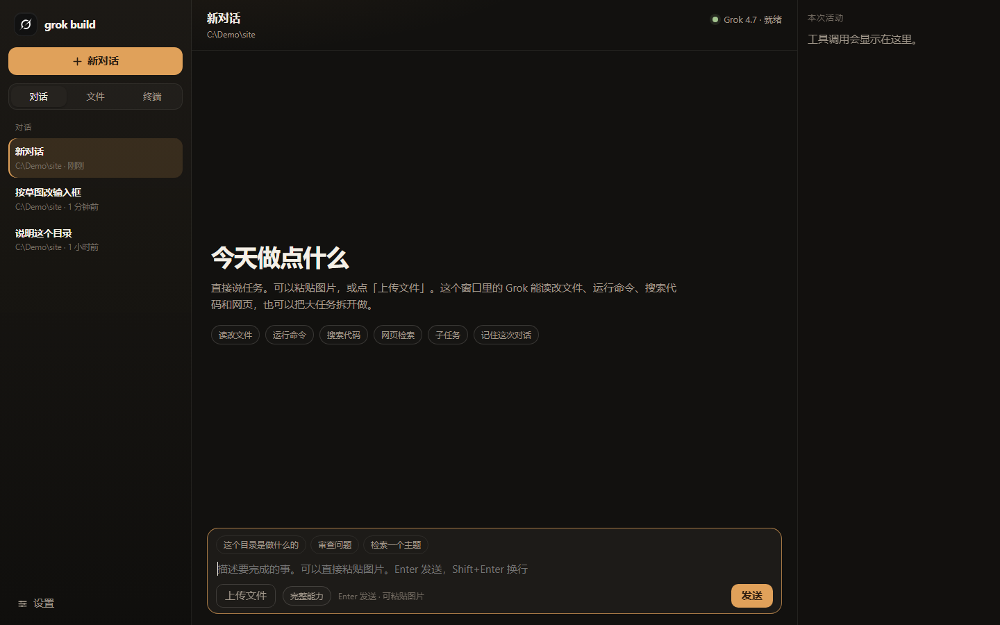
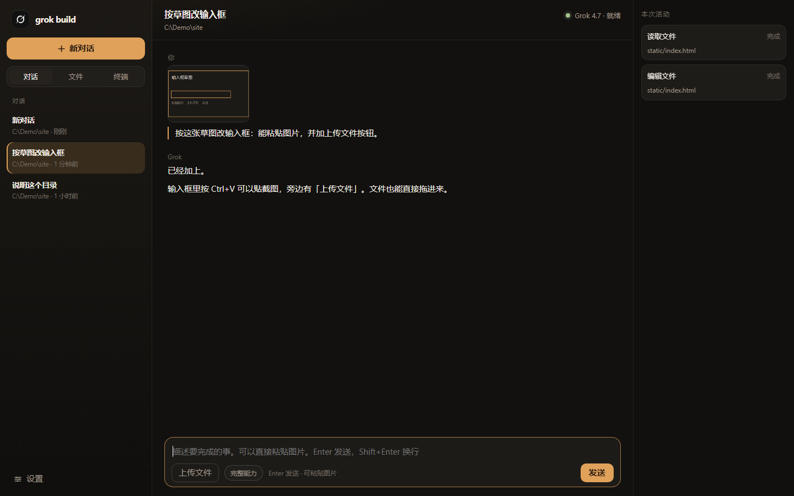
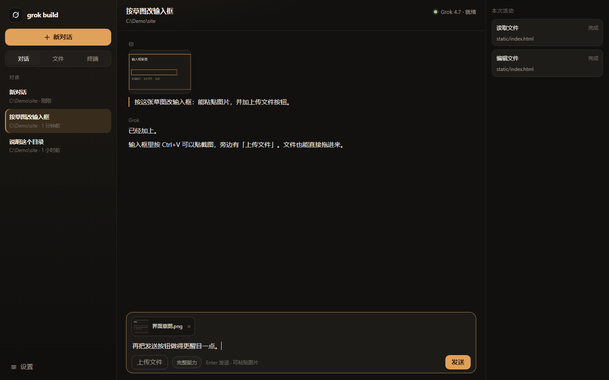
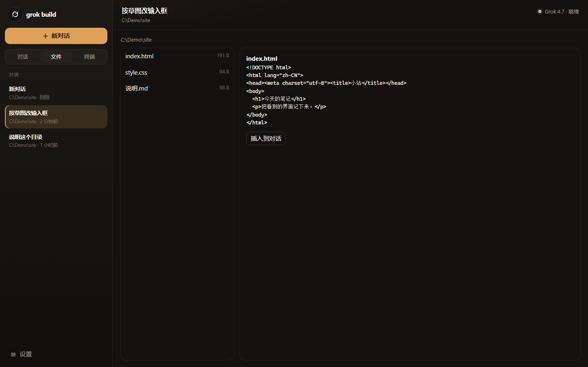
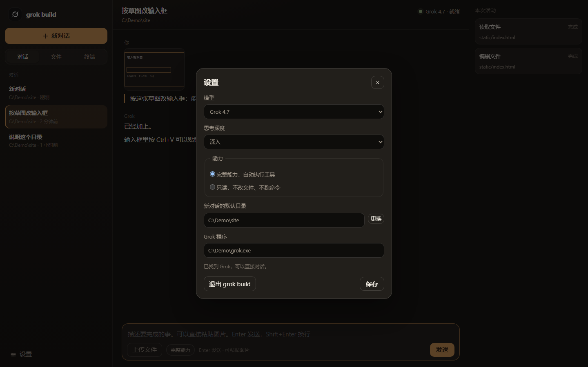

# Grok 工作台

Windows 上的中文图形界面，用来使用 [Grok Build](https://x.ai/cli)。

Grok Build 本身是终端里的编程助手：能读项目、改文件、跑命令、查网页。这个工作台把它放进一个普通窗口里，用鼠标和中文完成同样的事，不必记终端快捷键。

程序只在你的电脑上运行。窗口连的是本机地址 `127.0.0.1`，不对外开端口。对话记录保存在程序旁边的 `data` 文件夹。发给模型的内容仍会按你的 Grok 账号送到 SpaceXAI，这一点和直接运行 `grok` 相同。

这个仓库**不包含**官方的 `grok.exe`，也**不包含**任何人的登录状态、对话记录或浏览器数据。每个人用自己的 Grok 账号。

## 界面

下面是程序窗口的截图。对话内容是示例，目录也是示例路径。

打开后是这样。左侧选对话，中间输入任务，右侧看这一轮做了什么。



把一张界面草图贴进对话，它会按图改。右侧记下读过和改过的文件。



接着发下一条时，图片会出现在输入框里，旁边是「上传文件」。也可以把文件拖进来。



「文件」页可以浏览当前目录，预览内容，再把路径放进对话。



「设置」里选模型、思考深度、能不能改文件，以及默认目录和 `grok.exe` 的位置。



## 下载后直接用

适合不想安装 Python 的人。只需要一个 exe。

1. 先安装 Grok Build。用管理员身份不必，普通 PowerShell 即可：

   ```powershell
   irm https://x.ai/cli/install.ps1 | iex
   ```

   装好后**新开一个** PowerShell，确认能找到命令：

   ```powershell
   grok --version
   ```

2. 登录一次。在 PowerShell 里运行 `grok`，按窗口里的提示用浏览器登录。登录成功后就可以关掉那个终端窗口。登录信息记在你的用户目录 `%USERPROFILE%\.grok`，工作台会沿用它。

3. 打开本仓库的 **Releases**，下载 `GrokWorkbench.exe`。

4. 把 exe 放到一个单独的文件夹里，例如 `D:\GrokWorkbench\`。不要只放在压缩包里直接运行。双击 `GrokWorkbench.exe`。

5. 第一次会用 Microsoft Edge 打开一个应用窗口。没有安装 Edge 时，会改用系统默认浏览器。

6. 点窗口顶部的目录，选你要让它处理的项目文件夹。也可以在「设置」里改「新对话的默认目录」。

7. 在下方输入框写任务，按 Enter 发送。

如果提示找不到 Grok，打开「设置」，把「Grok 程序」填成实际的 `grok.exe`。默认位置是：

```text
%USERPROFILE%\.grok\bin\grok.exe
```

## 从源码运行

适合要改界面或自己打包的人。需要 Windows，以及 Python 3.11 或更新版本（安装时勾选 py 启动器）。

1. 同样先按上一节安装并登录 Grok Build。
2. 下载本仓库的源码并解压，或执行：

   ```powershell
   git clone https://github.com/chenjuly13-hub/grok-workbench.git
   cd grok-workbench
   ```

3. 启动：
   - 双击 `启动 Grok 工作台.vbs`：没有黑色命令行窗口。
   - 或双击 `启动 Grok 工作台.bat`：能看到报错，适合排查问题。

源码运行不需要 `pip install`。界面用的是 Python 自带的库。

## 窗口里有什么

左侧是对话列表。

- **新对话**：另开一轮，不接着上一轮的上下文。
- **对话 / 文件 / 终端**：三块工作区。
- **设置**：模型、思考深度、能力、默认目录、`grok.exe` 路径，以及退出程序。

中间是当前对话。

- 顶栏标题可以点，用来改名。
- 标题下面的目录可以点，只换这一轮对话的工作目录。换目录之后，这一轮不再接着旧的上下文。
- Enter 发送，Shift+Enter 换行。
- **Ctrl+V** 可以把截图或复制的图片贴进输入框。
- **上传文件** 可以选择图片、文档或其他文件。也可以把文件拖进输入框。
- 一次最多 8 个附件，每个不超过 20 MB。图片会先交给 Grok 查看，再按画面回答。
- 点附件上的 × 可以在发送前去掉。

右侧「本次活动」列出这一轮用过的工具。回复正文下面不再重复贴「读取文件」「运行命令」这类标签。

文件页可以浏览当前目录，预览文本和图片，并把路径放进对话。终端页在当前目录运行 PowerShell，适合看一眼命令输出。改代码、跑测试这类事，直接在对话里说即可。

## 设置里的选项

| 项目 | 含义 |
| --- | --- |
| 模型 | 默认 Grok 4.7。也可以选快速或其他已列出的型号。 |
| 思考深度 | 快速、标准、深入、更深入。任务越长，越适合用后面的档。 |
| 完整能力 | 允许改文件、运行命令、拆子任务。工具会自动执行。 |
| 只读 | 只查看和回答，不改文件、不跑命令。 |
| 新对话的默认目录 | 新建对话时使用的文件夹。 |
| Grok 程序 | `grok.exe` 的完整路径。 |

## 数据放在哪里

程序会在自己旁边创建 `data`：

| 路径 | 内容 |
| --- | --- |
| `data\config.json` | 模型、目录、能力、`grok.exe` 路径 |
| `data\sessions` | 这个窗口里的对话记录 |
| `data\uploads` | 你粘贴或上传的附件 |
| `data\server.log` | 启动和报错日志 |
| `data\edge-profile` | 仅给这个窗口用的 Edge 配置，不是你日常浏览器的配置 |

删除某个对话时，工作台会同时删掉它的附件。不要把 `data` 提交到 Git。仓库里的 `.gitignore` 已经排除了它。

关掉窗口**不会**退出程序，服务还在后台，这样再次打开能回到原来的页面。要真正退出，点「设置」里的「退出 grok build」。

## 自己打包 exe

在源码目录打开 PowerShell：

```powershell
powershell -ExecutionPolicy Bypass -File .\build.ps1
```

完成后得到 `dist\GrokWorkbench.exe`。把这一个文件复制给别人即可。对方的电脑仍然要单独安装并登录 Grok Build。

打包用的是 PyInstaller。个别杀毒软件会把这类单文件 exe 误报，可以改用上一节的源码方式运行。

## 常见问题

**双击 exe 没有窗口。**  
先看程序旁边有没有 `data\server.log`。如果写着已经在运行，再双击一次，它会打开已有窗口。如果端口被占用，退出工作台后再开。

**提示找不到 Grok。**  
说明还没安装，或 `grok.exe` 不在默认位置。按「下载后直接用」安装，然后在设置里填对路径。

**登录窗口没有出现。**  
工作台不负责注册账号。先在 PowerShell 里运行一次 `grok` 并完成登录。

**粘贴图片没有反应。**  
点一下输入框，再按 Ctrl+V。从资源管理器复制的文件也可以粘贴。如果贴进去的是一段文件路径而不是图片，用「上传文件」或把文件拖进来。

**它会改我的文件吗？**  
「完整能力」下会。让它做事之前，看清顶栏的目录是不是你要的那个文件夹。只想让它看、不想让它改，把能力换成「只读」。

**换了一台电脑还要登录吗？**  
要。exe 里没有你的账号。在新电脑上安装 Grok Build 并登录一次。

## 它是怎么工作的

1. 启动后在 `127.0.0.1` 上打开一个只供本机访问的页面。
2. Edge 以应用窗口打开这个页面。
3. 你发送一条消息时，工作台把文字和附件说明写成临时文件，然后运行：

   ```text
   grok.exe --prompt-file <文件> --output-format streaming-json --cwd <当前目录> ...
   ```

4. Grok 的输出按行读回来，显示成回复、思考和右侧的活动记录。
5. 同一轮对话会带上 Grok 的会话编号，所以后面的话能接着前面的上下文。新对话或更换目录会重新开始。

因此，工作台是 Grok Build 的窗口，不是另一套模型。模型、额度和工具能力都以你本机安装的 Grok Build 为准。
